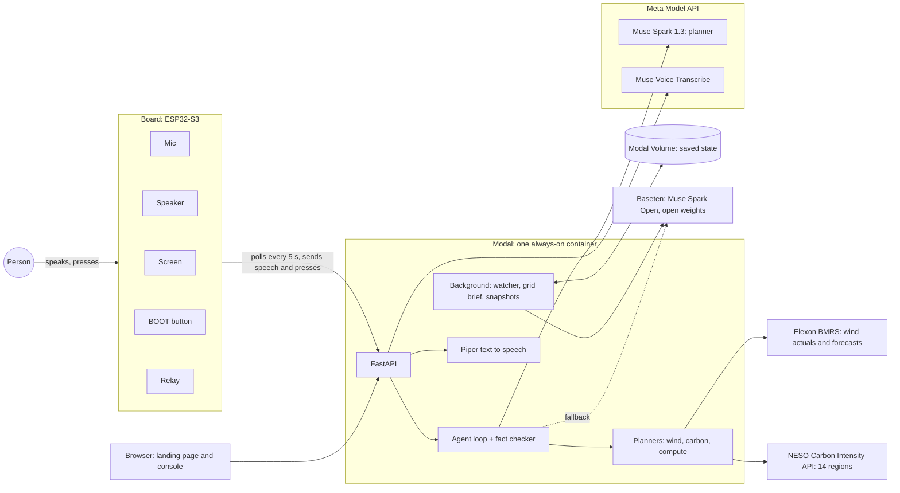
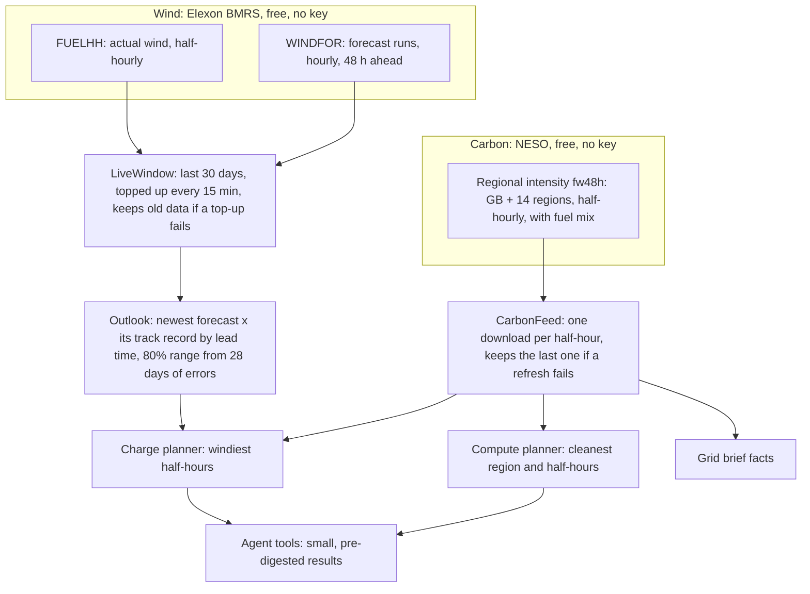
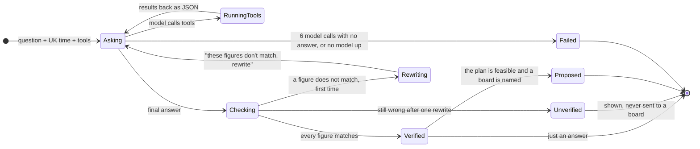
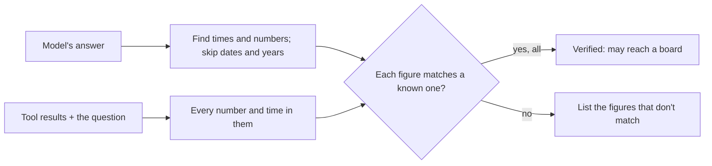
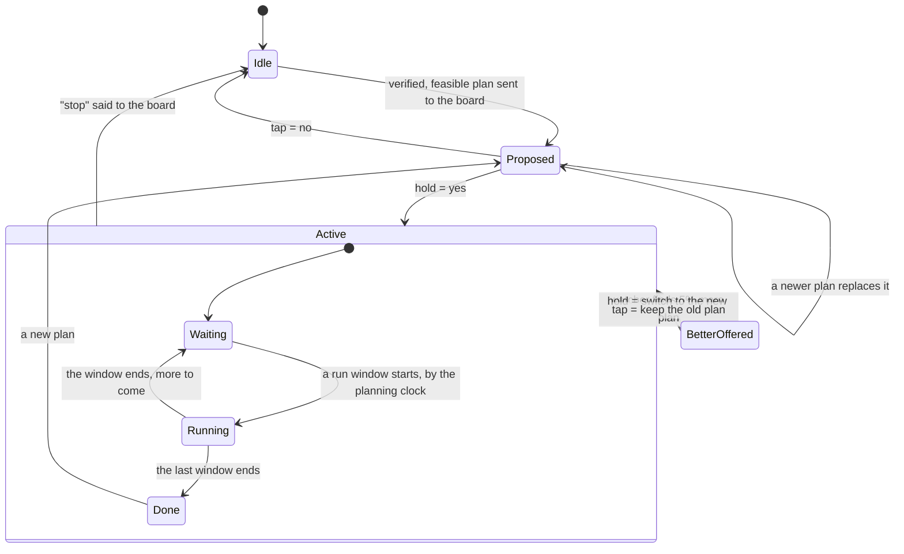
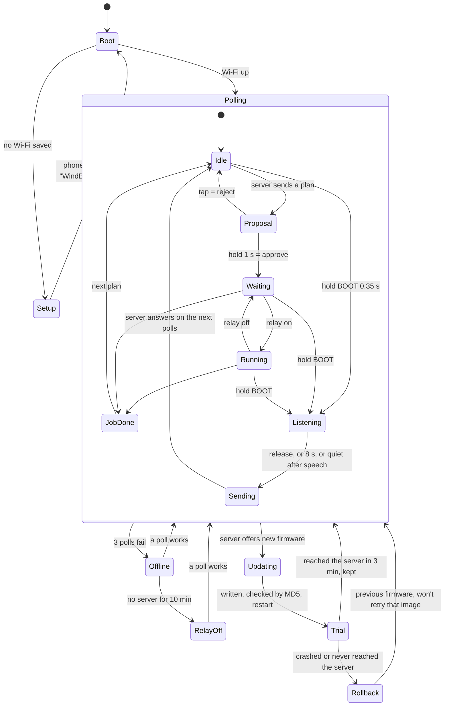
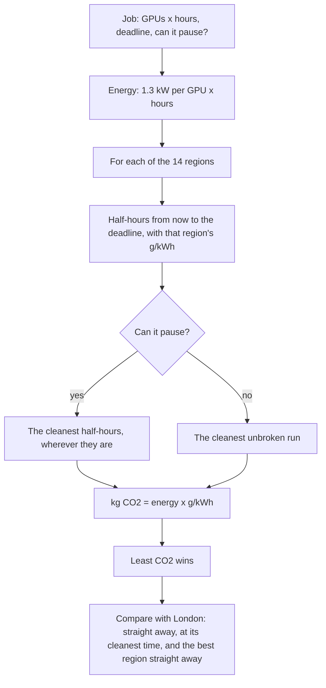
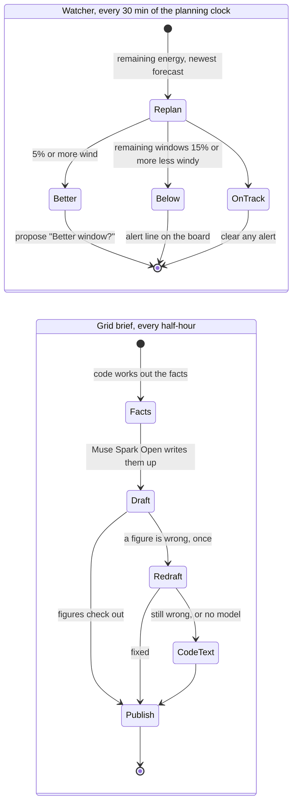
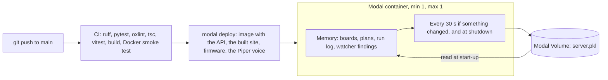

# Architecture

How Wind Buddy works, end to end: from a sentence spoken to the board, to a relay switching a load
in the windiest, cleanest hours. Every diagram matches the code; the file to read is named under
each one.

1. [The system](#1-the-system)
2. [Data pipelines](#2-data-pipelines)
3. [The agent: plan, check, rewrite](#3-the-agent-plan-check-rewrite)
4. [The fact checker](#4-the-fact-checker)
5. [A plan's life on the server](#5-a-plans-life-on-the-server)
6. [The board](#6-the-board)
7. [Voice, end to end](#7-voice-end-to-end)
8. [Compute jobs: which region, and when](#8-compute-jobs-which-region-and-when)
9. [Background loops: the watcher and the grid brief](#9-background-loops-the-watcher-and-the-grid-brief)
10. [Memory, deployment and failure](#10-memory-deployment-and-failure)
11. [Code map](#11-code-map)

## 1. The system



- **The board is thin.** It shows what the server says, sends what it hears and presses, and
  switches the relay when told. It never decides anything.
- **The models propose, code decides.** Every number in a plan comes from a tested planner. The
  model only chooses which tools to call and explains the result, and its explanation is checked.
- **One process.** Boards, plans and the run log live in memory in one container, saved to a
  volume every 30 seconds.

## 2. Data pipelines



- **The planning clock.** Every planner works "as of" a moment from the clock. Live, that is now.
  In replay it moves through January 2026, and only forecasts published by then count, so there
  is no look-ahead.
- **Correcting the forecast.** In January the official day-ahead forecast ran high in 85% of
  hours. The expected value scales it by how metered wind compared with forecasts made as far
  ahead over the last 28 days, and the range comes from the spread of that ratio.
- **Carbon.** NESO forecasts grams of CO2 per kWh for GB and each distribution region. Wind makes
  it swing: on a windy night North Scotland is near 0 while the South West burns gas at 350 or
  more.

Code: `store.py` (LiveWindow), `outlook.py`, `elexon.py`, `carbon.py`.

## 3. The agent: plan, check, rewrite



The tools:

| Tool | Returns |
|---|---|
| `get_wind_outlook` | Hour-by-hour forecast, expected value and range, track record, windiest and calmest hour |
| `check_recent_wind` | How actual wind has tracked the forecast over the last few hours |
| `plan_charge` | Charging windows for a household load, wind while charging vs plugging in now, grid carbon; `goal: carbon` plans for the lowest carbon instead |
| `get_carbon_outlook` | GB carbon now and hour by hour, cleanest and dirtiest hours, every region ranked now |
| `plan_compute_job` | The region and half-hours with the least CO2 for a GPU job, against starting now in London |

Results are small and already worked out (UK times, whole numbers, every comparison as a
percentage), so the model never has to calculate. Models are tried in order: Muse Spark 1.3 on
the Meta Model API, then Muse Spark Open on Baseten. Every call records which model answered.

Code: `agent/runner.py`, `agent/tools.py`, `agent/llm.py`.

## 4. The fact checker



- Times ("02:00", "7 am") must appear in a tool result or the question.
- Numbers with a unit (MW, GW, kW, kWh, %, hours) must equal a known number, allowing honest
  rounding: "6,600 MW" or "6.6 GW" for 6,628, but not "7,200".
- Bare numbers up to 12 ("two windows") are not checked; larger ones are.
- Magnitudes are compared, not signs: "33% lower" matches a change of -33.3.

The same checker guards the watcher's notes and the grid brief. Code: `agent/factcheck.py`.

## 5. A plan's life on the server



- The relay is on exactly when the planning clock is inside one of the active plan's windows.
  In a fast replay the real relay follows simulated time.
- Each change bumps the board's state version, so the board knows to redraw.
- What the board says is built by code from the planner's numbers, in one or two sentences:
  "Here's my plan: charge from 2 am to 4 am, when the wind should be about 15 gigawatts, 50
  percent more than plugging in now. Hold the button for yes, or tap for no."

Code: `device.py` (registry, `screen`, `news`), `device_api.py`.

## 6. The board



- **One button.** Tap is no (or refresh), a 1 s hold is yes, and a hold in any other screen is
  push-to-talk. Holding 10 s resets Wi-Fi.
- **Fails safe.** No server for 10 minutes switches the load off.
- **Looked after remotely.** The board sends its last 30 log lines with each event, and installs
  firmware the server offers, with automatic rollback.

Code: `firmware/src/main.cpp`, `firmware/src/audio.h`, `firmware.py`.

## 7. Voice, end to end

```mermaid
sequenceDiagram
    actor P as Person
    participant B as Board
    participant S as Server
    participant V as Muse Voice Transcribe
    participant M as Muse Spark 1.3
    participant T as Piper
    P->>B: holds BOOT, "64 GPUs for 6 hours, where and when?"
    B->>S: POST /api/device/{id}/voice (16 kHz WAV)
    S->>V: transcribe
    V-->>S: text
    alt "stop charging"
        S->>S: stop the active plan
    else a question
        S->>M: agent loop with tools
        M-->>S: answer
        S->>S: fact check; propose a verified, feasible plan
    end
    B->>S: next poll
    S->>T: the plan in one or two sentences
    T-->>S: speech
    S-->>B: state, with the new clip's id
    B->>S: GET speech clip as ADPCM
    S-->>B: about 8 KB per second, played as it downloads
    B-->>P: "Here's my plan... hold the button for yes"
    P->>B: holds the button
    B->>S: approve
```

- Transcribing and planning take about 25 s of network calls. They run in a worker thread, so
  the server keeps answering polls meanwhile.
- Meta's API has no text to speech yet, so the voice is Piper (open source) on the server.

Code: `device_api.py` (`device_voice`, `announce`), `voice.py`.

## 8. Compute jobs: which region, and when



- A data centre can't follow the wind; the jobs inside it can. A checkpointed training run only
  has to finish by its deadline.
- The comparison splits the saving into moving in time and moving in place.
- The same allocator schedules EV charges, so both are covered by the same tests.

Code: `compute.py`, `flex.py` (`allocate`), `carbon_api.py` (`POST /api/compute/plan`).

## 9. Background loops: the watcher and the grid brief



- The watcher re-plans wind-led charges. Its note is written by Muse Spark Open and
  fact-checked, with a sentence written by code as the fallback.
- The brief gives the open-weight model a job every half-hour. `GET /api/brief` never waits on a
  model: it returns the newest brief.

Code: `watcher.py`, `watch_api.py`, `brief.py`.

## 10. Memory, deployment and failure



| What fails | What happens |
|---|---|
| Elexon top-up fails | The data already held keeps being served; retry in 2 minutes |
| NESO download fails | The last carbon forecast is used while it still reaches 42 hours ahead |
| Meta API fails | The next model in the list (Muse Spark Open on Baseten) answers |
| Every model fails | The run is recorded with its error; nothing reaches a board |
| A figure doesn't match | One rewrite, then the answer is marked unverified and never sent |
| The server restarts | Boards, plans and the run log come back from the volume |
| The board loses the server | "No connection" on screen; the relay goes off after 10 minutes |
| New firmware is broken | The board rolls back to the previous image by itself |
| Text to speech fails | The board's poll still works; it just doesn't speak |

Guards: `APP_TOKEN` protects the endpoints that cost money or change shared state, and
`DEVICE_TOKENS` gives each board its own token.

## 11. Code map

| Area | Files |
|---|---|
| App and routes | `backend/wind_monitor/main.py`, `api.py`, `planning_api.py`, `agent_api.py`, `device_api.py`, `watch_api.py`, `carbon_api.py` |
| Data | `elexon.py`, `store.py`, `outlook.py`, `analysis.py`, `carbon.py` |
| Planning | `flex.py` (charges), `compute.py` (compute jobs) |
| Agent | `agent/runner.py`, `agent/tools.py`, `agent/llm.py`, `agent/factcheck.py`, `agent/runs.py` |
| Board | `device.py`, `voice.py`, `firmware.py`, `firmware/src/` |
| Background | `watcher.py`, `brief.py`, `persist.py`, `clock.py` |
| Website | `frontend/src/landing/` (landing page), `frontend/src/views/` (console tabs), `frontend/src/lib/` (helpers and tests) |
| Deploy | `deploy/modal_app.py`, `.github/workflows/ci.yml`, `.github/workflows/deploy.yml` |
