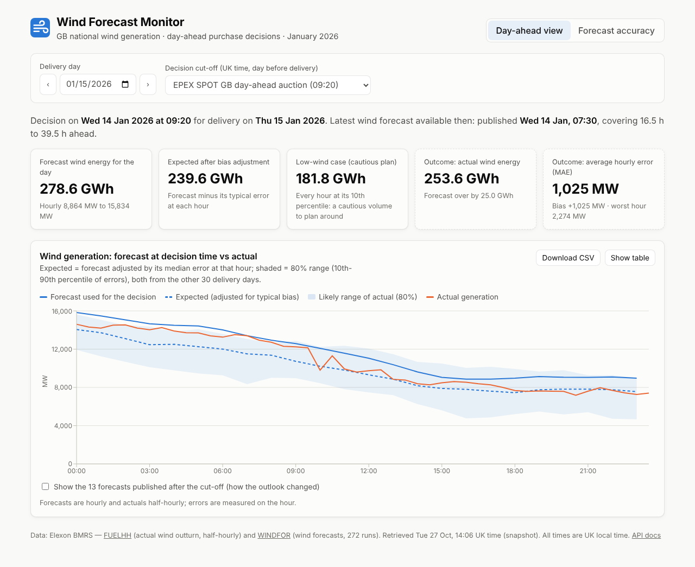
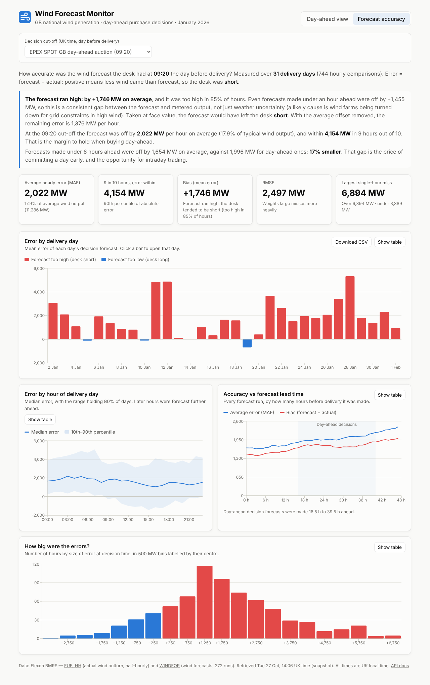

# Wind Forecast Monitor

A web app for a UK energy supplier's **day-ahead trading desk**. It answers two questions for
purchase decisions made in **January 2026**:

1. **What wind forecast did we have when we had to buy?** For each delivery day it shows the latest
   national wind generation forecast published before the day-ahead auction closed (09:20 UK
   time the day before, adjustable), with an 80% range from past forecast errors.
2. **How much can we trust it?** It measures the forecast against actual generation: average error,
   the margin that covers 9 hours in 10, whether it tends to leave the desk short or long, and how
   accuracy improves with fresher forecasts.

Data: Elexon BMRS [FUELHH](https://bmrs.elexon.co.uk/api-documentation/endpoint/datasets/FUELHH/stream)
(actual wind, half-hourly) and [WINDFOR](https://bmrs.elexon.co.uk/api-documentation/endpoint/datasets/WINDFOR/stream)
(wind forecasts).

**Live app:** _link added after deploying to Vercel (see [Deploying](#deploying-to-vercel))_



### What January 2026 shows

- At the 09:20 cut-off the desk had the **07:30 forecast run** every day, 16.5-39.5 hours ahead of delivery.
- The app always scores **the forecast the desk actually had**, never a later one. Scoring the newest forecast instead would make the error look 17-18% smaller than it really was at decision time.
- That forecast was off by **2,022 MW per hour on average** (18% of mean wind output), and by up to **4,154 MW in 9 hours out of 10**.
- It ran **high in 85% of hours, by 1,746 MW on average**, even when made under an hour ahead. This is a consistent gap between the forecast and metered output (likely curtailment), so taken at face value it leaves the desk **short**.
- Correcting for that typical offset cut the average error to **1,391 MW (−31%)**. The app shows this bias-adjusted expectation alongside the raw forecast.
- Forecasts made under 6 hours ahead are **17% more accurate** than day-ahead ones: the value of intraday re-trading.

Full method and caveats: [docs/DECISIONS.md](docs/DECISIONS.md) (A8, A10, A12).



**Design decisions:** [docs/DECISIONS.md](docs/DECISIONS.md) explains every choice (analysis and engineering) and the trade-offs.

**Architecture:** [docs/ARCHITECTURE.md](docs/ARCHITECTURE.md) has diagrams of the system, data pipeline, request flow and CI/CD, plus a table of every edge case and the test that covers it.

---

## Running it

### Option 1: Docker (one command)

```bash
docker compose up --build
```

Open http://localhost:8000. The API docs are at http://localhost:8000/api/docs.

### Option 2: Docker with hot reload (for development)

```bash
docker compose -f docker-compose.dev.yml up
```

The React dev server runs at http://localhost:5173 and the API at http://localhost:8000.

### Option 3: Without Docker

Requires Python 3.12+ and Node 22+.

```bash
# Backend (terminal 1)
cd backend
python -m venv .venv && source .venv/bin/activate
pip install -r requirements-dev.txt
uvicorn wind_monitor.main:app --reload            # http://localhost:8000

# Frontend (terminal 2)
cd frontend
npm ci
npm run dev                                         # http://localhost:5173
```

### Tests and checks

```bash
cd backend  && ruff check . && ruff format --check . && pytest
cd frontend && npm run lint && npm run typecheck && npm test && npm run build
```

CI runs all of these, then builds the Docker image and smoke-tests it (`.github/workflows/ci.yml`).

### Live checks (need internet)

```bash
cd backend && CLOCK_MODE=live uvicorn wind_monitor.main:app      # terminal 1
python scripts/live_check.py                                     # planning API on real Elexon data
BASETEN_API_KEY=... python scripts/model_check.py --api http://localhost:8000   # model providers
python scripts/compare_corrections.py --live                     # offset vs ratio correction
```

`model_check.py` checks each provider whose key is set (`MODEL_API_KEY` for Muse Spark on the
Meta Model API, `BASETEN_API_KEY` for Muse Spark Open): the model is listed, replies, calls a
tool, and answers from a real plan.

```bash
python scripts/backtest.py [--live]          # charging strategies vs actual wind, night by night
MODEL_API_KEY=... python scripts/agent_eval.py   # the real agent on 27 January nights
```

Results are in [docs/DECISIONS.md](docs/DECISIONS.md) (C9).

### The agent

Set `MODEL_API_KEY` (Meta Model API) and/or `BASETEN_API_KEY`, start the API, then:

```bash
curl -s localhost:8000/api/agent/ask -H 'content-type: application/json' \
  -d '{"question": "My EV needs 21 kWh at 7 kW by 07:00. When should it charge?"}'
```

| Variable | Default | Meaning |
|---|---|---|
| `PLANNER_MODELS` | `meta:muse-spark-1.3,baseten:meta-models/muse-spark-open-1026` | Models for the agent, tried in order |
| `PLANNER_REASONING_EFFORT` | `low` | How long models think (Meta and Baseten) |

### Refreshing the data

The app serves a snapshot of the January 2026 data committed in `backend/data/`. That data is
historical, so it no longer changes. To re-download it:

- **On GitHub:** Actions tab → *Refresh data snapshot* → *Run workflow*. It commits the new snapshot.
- **Locally:** `python backend/scripts/fetch_snapshot.py` (also prints a profile of the data).

Set `DATA_SOURCE=live` to skip the snapshot and call Elexon directly.

| Variable | Default | Meaning |
|---|---|---|
| `DATA_SOURCE` | `auto` | `auto` (snapshot if present, else live), `snapshot`, or `live` |
| `SNAPSHOT_DIR` | `backend/data` | Where the snapshot CSVs live |
| `STATIC_DIR` | unset | Folder of the built React app to serve (set in Docker) |
| `ELEXON_BASE_URL` | `https://data.elexon.co.uk/bmrs/api/v1` | Elexon API base URL |
| `CLOCK_MODE` | `replay` | Planning clock: `replay` (moves through January 2026) or `live` (real time, rolling live data) |
| `REPLAY_START` | `2026-01-14T09:00` | Where the replay clock starts (no zone = UK time) |
| `REPLAY_SPEED` | `0` | Simulated seconds per real second (0 = paused) |

---

## Files and directories

```
.
├── backend/                     Python API (FastAPI)
│   ├── wind_monitor/
│   │   ├── config.py            Business rules: study window, auction cut-offs, time zone; env settings
│   │   ├── elexon.py            Elexon client (chunking, retries) + conversion to tidy tables
│   │   ├── store.py             Where data comes from: committed snapshot or live Elexon; in-memory cache
│   │   ├── analysis.py          Core logic: forecast available at the cut-off, errors, metrics, 80% band
│   │   ├── schemas.py           API response models (the contract, shown at /api/docs)
│   │   ├── api.py               HTTP routes: /api/meta, /api/day, /api/accuracy, /api/health
│   │   └── main.py              App setup: routes, CDN cache headers, serving the built React app
│   ├── scripts/fetch_snapshot.py  Downloads the data from Elexon and prints a data profile
│   ├── data/                    The committed data snapshot (CSV + metadata)
│   ├── tests/                   pytest: analysis rules, Elexon client, store, API end to end
│   ├── requirements.txt         Pinned runtime dependencies
│   ├── requirements-dev.txt     + test and lint tools
│   └── pyproject.toml           Ruff and pytest settings
├── frontend/                    React + TypeScript app (Vite)
│   └── src/
│       ├── App.tsx              Layout, tabs, shared controls (delivery day, cut-off)
│       ├── api.ts               Typed API client mirroring backend/schemas.py
│       ├── views/               DayView (day-ahead decision) and AccuracyView (forecast accuracy)
│       ├── charts/              Recharts charts for each view
│       ├── components/          Stat tiles, chart cards with table view, controls
│       ├── lib/                 Formatting (UK time), CSV export, data hooks, insight maths (+ tests)
│       └── index.css            Design tokens (light/dark) and layout
├── api/index.py                 Vercel entry point: exposes the FastAPI app as a serverless function
├── vercel.json                  Vercel build and routing (/api/* → Python, everything else → React)
├── Dockerfile                   Multi-stage image: build React, then serve API + site with Python
├── docker-compose.yml           Run the production image locally
├── docker-compose.dev.yml       Hot-reload development setup
├── .github/workflows/
│   ├── ci.yml                   Lint, type-check, test, build, Docker smoke test
│   └── refresh-data.yml         Manual job that re-downloads the Elexon data snapshot
├── docs/
│   ├── ARCHITECTURE.md          Diagrams (Mermaid), caching, error handling, edge cases
│   ├── DECISIONS.md             Design decisions, data findings and trade-offs
│   └── screenshots/             Screenshots of the two views (real January 2026 data)
├── requirements.txt             Points Vercel at backend/requirements.txt
└── .python-version              Python 3.12 for Vercel, CI and local tools
```

## API

| Endpoint | Returns |
|---|---|
| `GET /api/meta` | Scope (decision and delivery dates), cut-off presets, data provenance |
| `GET /api/day?delivery_date=2026-01-15&cutoff=09:20` | The forecast used for that day, its 80% range, actuals, errors, and every forecast run around the decision |
| `GET /api/accuracy?cutoff=09:20` | Error summary, by delivery day, by hour, by lead time, and a histogram |
| `GET /api/health` | Liveness check |
| `GET /api/clock`, `POST /api/clock` | The planning clock; in replay mode, jump, step or change speed |
| `GET /api/outlook?hours=24` | Forecast as of the clock, bias-corrected with a likely range, and how actual wind has tracked it recently |
| `POST /api/plan` | Schedule a flexible job (kWh, kW, deadline) into the windiest half-hours |
| `POST /api/agent/ask` | Ask the agent (Muse Spark); every figure in its answer is fact-checked against its tool results |
| `GET /api/agent/runs`, `GET /api/agent/runs/{id}` | Log of agent runs: answer, check, models used, every tool call |

Interactive documentation: `/api/docs`.

## Deploying to Vercel

1. Import this GitHub repository at https://vercel.com/new.
2. Keep the defaults. `vercel.json` sets the build (`frontend/` with Vite), the output directory, and
   the Python function (`api/index.py`, dependencies from `requirements.txt`).
3. Deploy. The site is served from Vercel's CDN, and `/api/*` runs FastAPI.

## Use of AI tools

This project was built with the help of **Claude Code** (Anthropic) as an AI pair programmer. It
was used to research the domain (Elexon datasets, GB day-ahead auction times), scaffold the
project, write code, tests and documentation, and review the design. The design decisions and
trade-offs are written up in [docs/DECISIONS.md](docs/DECISIONS.md).
