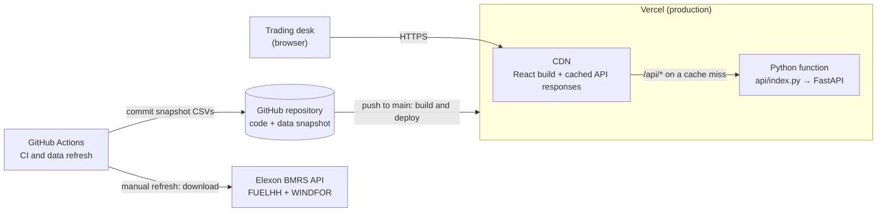
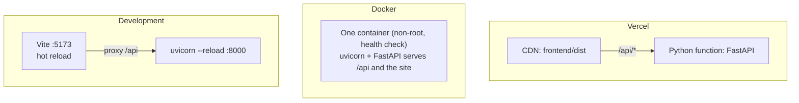
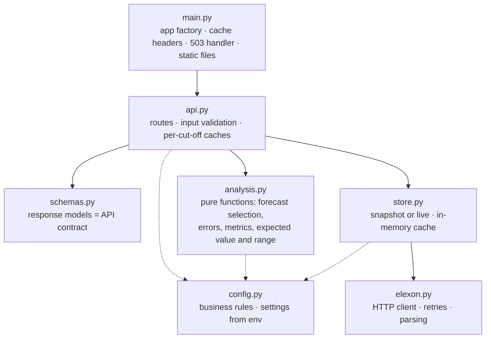
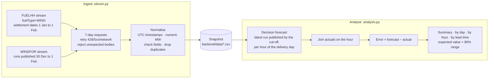
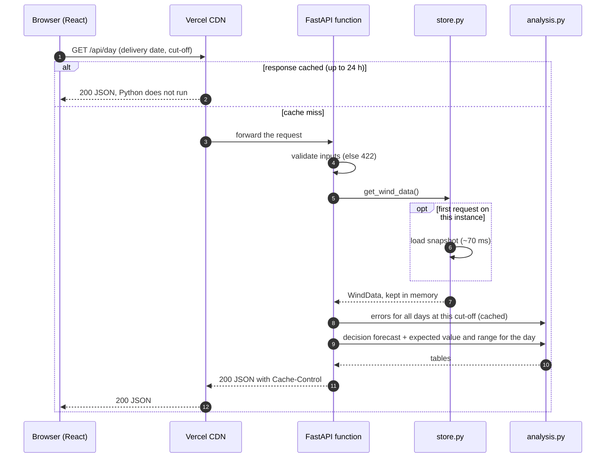
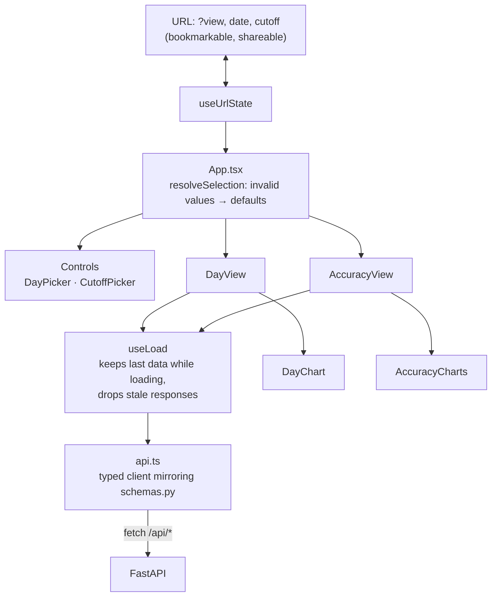
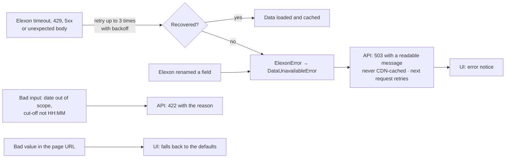
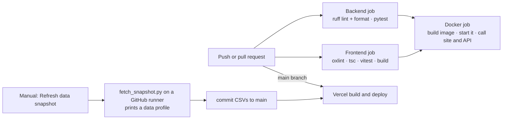

# Architecture

How the Wind Forecast Monitor is built, how data flows through it, and how it behaves when
things go wrong. The reasons behind each choice are in [DECISIONS.md](DECISIONS.md); this
document describes the result.

**In one paragraph:** a React single-page app talks to a small, stateless FastAPI service on
the same origin. The service loads a snapshot of Elexon wind data (January 2026) into memory
once per instance, and computes everything on request from pure pandas functions, caching the
results. There is no database, no login and no secret. The same code runs as a Vercel
deployment (CDN plus one Python function), a single Docker container, or a hot-reload
development setup.

---

## 1. System context

- **The browser only ever talks to one origin.** Static files come from the CDN; `/api/*` is
  rewritten to the Python function, so there is no CORS setup.
- **Elexon is not on the request path.** The function serves the snapshot bundled at deploy
  time, so a slow or unavailable Elexon cannot slow down or break a demo. Elexon is only
  called by the refresh workflow (or when `DATA_SOURCE=live`).

## 2. Runtime shapes

| | Vercel (production) | Docker (`docker compose up`) | Development |
|---|---|---|---|
| Website | Vercel CDN serves `frontend/dist` | FastAPI serves the build from `STATIC_DIR` | Vite dev server on :5173 (hot reload) |
| API | `api/index.py` serverless function | Same container, uvicorn on :8000 | uvicorn `--reload` on :8000 |
| Routing | `vercel.json` rewrites `/api/*` | One app, `/api` routes first, then static files | Vite proxies `/api` to :8000 |
| Data | Snapshot bundled with the function | Snapshot copied into the image | Snapshot on disk (or `DATA_SOURCE=live`) |

## 3. Backend structure

Rules the layering follows:

- **Dependencies point one way** (down the diagram). Nothing imports `api.py` except `main.py`.
- **`analysis.py` does no I/O.** It takes tables in and returns tables or dicts, so every
  business rule is tested with small hand-made tables (`tests/test_analysis.py`).
- **Business rules live in `config.py`** (study window, auction cut-offs, time zone), not
  scattered as literals.
- **Routes stay thin:** validate input, call analysis, shape the response.

## 4. Data pipeline

**Data model (in memory, all times UTC):**

| Table | Columns | Grain | Rows (Jan 2026) |
|---|---|---|---|
| actuals | `start_time`, `generation_mw` | one half-hour | 1,536 |
| forecasts | `publish_time`, `start_time`, `generation_mw` | one run × one target hour | 19,856 (272 runs) |
| errors (derived) | `delivery_date`, `start_time`, `publish_time`, `forecast_mw`, `actual_mw`, `error_mw`, `lead_hours`, `hour` | one delivery hour | 744 per cut-off |

The snapshot is three files: `wind_actuals.csv` (40 KB), `wind_forecasts.csv` (~0.9 MB) and
`snapshot_meta.json` (when and where it was downloaded).

## 5. The core rule: which forecast did the desk have?

For delivery day D, the decision is made at the cut-off on D-1. WINDFOR publishes a new run
about every 2-4 hours. For each hour of D we use the **latest run published at or before the
cut-off**:

```mermaid
flowchart LR
    r1["D-1 02:30 run"] --> r2["04:30 run"] --> r3["07:30 run<br/>used at the 09:20 cut-off"]
    r3 --> g1{{"09:20<br/>EPEX gate closure"}}
    g1 --> r4["09:30 run<br/>used at the 09:50 cut-off"]
    r4 --> g2{{"09:50<br/>N2EX gate closure"}}
    g2 --> later["11:30 … 22:30 runs<br/>published after the decision"]
    later --> dday["Delivery day D<br/>00:00 to 24:00 UK time"]

    classDef used fill:#2a78d6,color:#ffffff,stroke:#2a78d6
    classDef gate fill:#fcfcfb,stroke:#e34948,color:#0b0b0b
    class r3,r4 used
    class g1,g2 gate
```

The 07:30 run is used at the 09:20 cut-off and the 09:30 run at 09:50. Runs published later
are shown only as "how the outlook changed", never used for the decision. Times above are
UTC, which equals UK time in January; the code converts with `Europe/London`, so summer
cut-offs are correct too.

## 6. Request lifecycle

Measured locally on the real snapshot: loading the snapshot takes ~70 ms; `/api/day` takes
~30 ms once the cut-off has been computed (~110 ms the first time); `/api/accuracy` takes
~180 ms the first time and ~8 ms after. Responses are 17-31 KB of JSON.

## 7. Frontend structure

- **State:** the URL is the single source of truth for what is selected, so the back button,
  bookmarks and shared links all work. There is no global state library.
- **Data loading:** `useLoad` keys each request by its inputs. A response for a selection the
  user has already left is ignored, and the previous screen stays visible (dimmed) while the
  next one loads.
- **Contract:** `api.ts` types mirror `schemas.py`, so a changed field breaks the TypeScript
  build rather than the page.
- **Formatting:** all times are shown in `Europe/London`, whatever the viewer's time zone.

## 8. Error handling

## 9. Build, test and deploy

Pushes made by the workflow's built-in token do not trigger other workflows (a GitHub rule),
so a data refresh redeploys on Vercel but does not re-run CI. The next code push does.

## 10. Caching

| Layer | What | Lifetime | Invalidation |
|---|---|---|---|
| Vercel CDN | `/api/meta`, `/api/day`, `/api/accuracy` responses | 24 h (`s-maxage`), then served stale while revalidating | Every deploy starts a fresh cache |
| Browser | Same responses | 5 min (`max-age`) | — |
| Process | `WindData` (the loaded snapshot) | Life of the function instance or container | Restart / redeploy |
| Process | Errors, accuracy result and lead-time profile per cut-off | Same | Same (bounded: at most 1,440 cut-offs) |

Only successful responses are cacheable. Errors (422, 503) carry no cache header, so a
temporary failure is never pinned in the CDN.

## 11. Security and operations

- **Read-only, public data:** no login, no user data stored, no secrets or API keys.
- **Input validation:** dates must be real and in scope; cut-offs must match `HH:MM`. Anything
  else gets a 422 before any work is done.
- **Container:** runs as a non-root user, with a health check on `/api/health`, and only
  runtime files are copied in (`.dockerignore` keeps tests, `.git` and env files out).
- **Dependencies:** pinned in `requirements.txt` and `package-lock.json`.
- **Logging:** requests and data-load failures are logged to stdout, so they show up in Vercel
  and Docker logs.

---

## 12. Edge cases

Each case, what the system does, and the test that proves it. Backend tests are in
`backend/tests/`; frontend tests are in `frontend/src/lib/*.test.ts(x)`.

### Data source

| Case | Behaviour | Test |
|---|---|---|
| Long date ranges | Split into 7-day requests | `test_elexon::test_actuals_request_is_split_into_week_chunks_with_wind_filter`, `test_forecast_request_uses_publish_time_window_in_utc` |
| Rate limit (429), server error (5xx), network failure | Retried up to 3 times with backoff (1 s, 2 s), then a clear error | `test_retries_on_rate_limit_then_succeeds`, `test_network_errors_are_retried`, `test_gives_up_after_max_attempts` |
| Other client errors (4xx) | Fail fast, no retry | `test_bad_request_is_not_retried` |
| 200 response that is HTML or the wrong JSON shape | Treated as a failure: retried, then a clear error | `test_html_page_with_status_200_is_retried_then_reported`, `test_json_that_is_not_a_list_of_records_is_rejected` |
| Records wrapped as `{"data": [...]}` | Accepted | `test_accepts_wrapped_data_payload` |
| Elexon renames a field | Clear "missing fields" error, shown to users as 503 | `test_renamed_fields_raise_a_clear_error`, `test_store::test_elexon_schema_change_is_reported_as_data_unavailable` |
| Data cannot load at runtime | 503 with a readable message; not cached; the next request retries | `test_api::test_data_outage_returns_503_with_a_readable_message`, `test_store::test_failed_load_is_reported_and_not_cached` |
| No snapshot present | `auto` mode calls Elexon; `snapshot` mode fails loudly | `test_auto_mode_falls_back_to_live`, `test_snapshot_mode_fails_loudly_without_snapshot` |

### Data quality

| Case | Behaviour | Test |
|---|---|---|
| An actual is republished with a correction | Latest publication wins | `test_actuals_frame_keeps_wind_only_and_latest_publication` |
| Other fuel types in the response | Filtered out | same |
| Duplicate forecast rows (overlapping requests) | Dropped | `test_forecasts_frame_drops_duplicate_rows` |
| Missing or non-numeric generation | Row dropped | `test_rows_without_a_usable_generation_value_are_dropped` |
| Empty response | Empty tables with the right column types | `test_empty_responses_give_typed_empty_tables` |
| Forecast runs include hours already past at publication (seen in real data) | Excluded from "later forecasts" and from the lead-time analysis | `test_runs_for_day_drop_hours_already_past_at_publication`, `test_lead_time_buckets_and_skips_forecasts_made_after_the_target` |
| Missing half-hours on a delivery day | No daily total (it would understate the day); coverage reported, e.g. "47 of 48 half-hours" | `test_day_energy_is_withheld_when_any_period_is_missing`, `test_day_reports_coverage_and_withholds_totals_from_partial_data` |

### Time

| Case | Behaviour | Test |
|---|---|---|
| Cut-off is UK local time on the day before delivery | Converted with `Europe/London` | `test_cutoff_is_uk_time_on_the_day_before_delivery` |
| British Summer Time | 09:20 UK = 08:20 UTC | `test_cutoff_respects_british_summer_time`, frontend `shifts to BST in summer` |
| Clock-change days (23 or 25 hours) | Delivery window and expected periods follow the real day length | `test_clock_change_day_is_23_hours_long`, `test_day_energy_on_a_23_hour_clock_change_day` |
| Run published exactly at the cut-off | Counts as available | `test_run_published_exactly_at_cutoff_counts_as_available` |
| Run published after the cut-off | Never used for the decision | `test_picks_latest_run_published_before_cutoff` |
| Latest run does not cover every hour | Older runs fill the gaps, per hour | `test_older_run_fills_hours_the_latest_run_does_not_cover` |
| Forecast targets outside the delivery day | Ignored | `test_ignores_targets_outside_the_delivery_day` |
| Hourly forecasts vs half-hourly actuals | Compared on the hour only; no invented values | `test_errors_compare_on_the_hour_with_forecast_minus_actual` |
| Viewer in another time zone | Everything displayed in UK time | frontend `shows GMT times unchanged in winter`, `includes the weekday and date` |
| Calendar dates near midnight | Formatted without shifting the day | frontend `formats without shifting the day` |

### Analysis

| Case | Behaviour | Test |
|---|---|---|
| No forecast published before the cut-off for a day | `decision_run` is null; the page says so and still shows actuals | `test_api::test_day_without_data_still_answers` |
| No days or no data | Empty results, not errors | `test_decision_errors_with_no_days_is_an_empty_table`, `test_error_summary_of_nothing` |
| Too few past errors at an hour (<10) | Uses the all-hours spread | `test_band_ignores_an_hour_with_too_few_samples`, `test_band_falls_back_to_all_hours_when_hour_has_no_history` |
| Too little history overall (<10) | No expected value or range shown | `test_no_band_from_too_little_history` |
| Range would go below 0 MW | Clipped at 0 | `test_band_low_case_uses_high_error_quantile_and_is_clipped_at_zero` |
| The day being viewed | Excluded from its own expected value and range | `test_api::test_day_band_comes_from_other_days_errors` |
| All errors identical | Histogram has a single bin | `test_histogram_when_every_error_is_the_same` |
| Near-zero wind | MAPE is not used, because it explodes; nMAE divides by mean output instead | design (DECISIONS A7) |

### API input

| Case | Behaviour | Test |
|---|---|---|
| Delivery date outside 2 Jan to 1 Feb, or not a date | 422 with the allowed range | `test_api::test_day_rejects_bad_input` |
| Cut-off not `HH:MM` (`9:20`, `24:00`) | 422 | same |
| Any valid custom cut-off | Computed once, then cached | `test_later_cutoff_uses_later_run`, `test_accuracy_is_computed_once_per_cutoff` |

### Frontend

| Case | Behaviour | Test |
|---|---|---|
| Malformed or out-of-scope URL (`date=2026-02-30`, `cutoff=abc`) | Falls back to the defaults | `selection.test.ts` |
| User changes day before the previous answer arrives | The stale answer is ignored (the test was checked to fail without this guard) | `hooks.test.tsx`: "ignores a slow response…" |
| Loading the next selection | Previous screen stays, dimmed, with no layout jump | `hooks.test.tsx`: "keeps the previous data…" |
| API error | Message shown, last good data kept | `hooks.test.tsx`: "reports an error…" |
| Back / forward buttons | Selection follows the URL | `hooks.test.tsx`: "follows the browser back button" |
| Decision forecast unusually old (>6 h at the cut-off) | Note shown next to the publish time | `selection.test.ts`: "measures how old…" |
| Incomplete day | Tiles say "47 of 48 half-hours" instead of a misleading total | API coverage tests above |
| Phone-width screens, dark mode, colour-blind users | No horizontal scroll at 390 px; palette validated in both themes; every chart has a table view | checked with Playwright screenshots and the palette validator |

### Known limitations (not handled on purpose)

- The expected value and range use other January days, including later ones. That is fine
  for evaluating January, but a live tool must use past days only (DECISIONS, "What I would do
  next").
- On a 25-hour clock-change day the repeated hour is grouped as one hour of day.
- The API serves only the January 2026 window. Extending it means a scheduled refresh and a
  small database behind `store.py`; nothing else changes.
