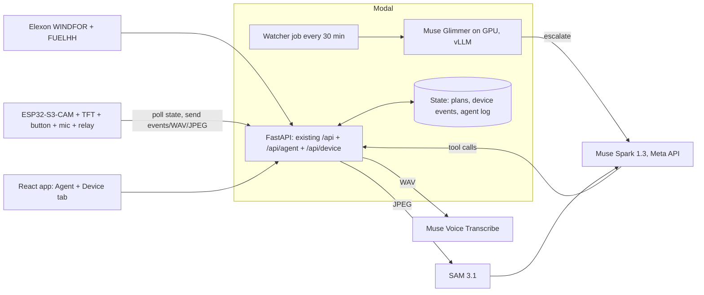

# Hackathon plan: Wind-following agent + ESP32 device

Meta Global AI Developer Hackathon, building period Oct 27 – Nov 4, 2026.
**Submission deadline: Wed Nov 4, 9:00 PM ET (Thu Nov 5, 7:30 AM IST).** Target: submit Nov 4, not at the deadline.

Track: **Push the Frontier** (energy; "control a physical system").

## 0. Progress

- **Day 1 (Oct 29), done:** planning clock (live / January replay), outlook with a ratio correction
  (docs/DECISIONS.md C1-C6), live Elexon window, scheduler, `/api/clock`, `/api/outlook`, `/api/plan`,
  live end-to-end checks.
- **Day 2 (Oct 30), done:** agent on Muse Spark with tools, fact checker and one rewrite; model
  client with fallback (Meta -> Baseten); `/api/agent/ask` and run log; backtest; agent evaluation
  (27/27 nights verified on both Muse Spark 1.3 and Muse Spark Open). Results: DECISIONS C7-C9.
- **Changed by the results:** re-planning on new forecast runs does not improve overnight charging
  (C9), so the watcher's job is to spot wind under-delivering and alert/pause, not to chase a better
  charging score. Muse Glimmer is not on the Meta Model API: it runs on our own Modal GPU.

---

## 1. The pitch

The wind forecast monitor (built Oct 27) found that GB's day-ahead wind forecast ran **high in 85% of
January hours, by ~1,750 MW on average**, which leaves a supplier **short**. Forecasts made under 6 hours
ahead were **17% more accurate** than day-ahead ones.

We turn that analysis into an **agent that acts on the physical world**:

1. Every morning it reads the forecast the desk has at the 09:20 auction cut-off, corrects it with the
   measured bias, and plans **when flexible demand should run** (one ESP32 = one home's EV charger or
   water heater; many = a virtual power plant).
2. Through the day it watches **actual wind vs the plan**. When wind under-delivers, it pauses loads
   (reducing the supplier's short position); when fresher forecasts arrive, it re-plans.
3. Every number it states is checked against tool results before anything is dispatched, and the
   device's camera checks the load really switched.

Pitch line: *"An agent that knows how far to trust the wind forecast, and a $10 device that acts on it."*

## 2. Models: each one where it fits

| Model | Where it runs | Job |
|---|---|---|
| **Muse Spark 1.3** | Meta Model API | Planner agent: tool calling over our analysis, morning plan, re-plans, explanations. Vision: reads the power meter display. |
| **Muse Glimmer (30B, open weights)** | Our own GPU on **Modal** (vLLM, scales to zero) | Always-on watcher: every 30 min compares actuals with the plan; escalates to Spark only when something changed. Targets the *Best Build on Meta Open Weight Models* bonus. |
| **Muse Voice Transcribe** | Meta Model API (REST, 16 kHz mono WAV) | Voice commands from the device mic ("car needs charging by 7"). |
| **SAM 3.1** | Meta Model API | Finds the meter display / appliance in the camera frame, so Spark reads a clean crop. |
| **Muse Spark Open** | Baseten (hosted) | Backup planner and watcher, already tested (2.4 s per question). |
| **Muse Code** | Our laptops | Used to write firmware/backend; mention in the submission. |

Fireworks: backup provider for Muse Spark Open, and the stretch goal of fine-tuning Muse Glimmer
there (Glimmer SFT is free on Fireworks until Nov 30). Do not spread work across providers.

**Design rule:** the LLM never does the arithmetic. Scheduling and scoring are deterministic Python
tools (tested); the agent decides *what* to ask, *when* to re-plan, and explains *why*.

## 3. Architecture

- **Hosting:** move the backend to Modal (`@modal.asgi_app`) so it can keep state and run a scheduled
  watcher (`modal.Period(minutes=30)`). The FastAPI app already serves the built React site, so one
  deploy covers both. Vercel stays as-is for the static monitor if we want.
- **Device protocol:** plain HTTPS polling every ~10 s (no MQTT broker to run):
  - `GET  /api/device/{id}/state` → screen lines, relay on/off, pending approval, plan version
  - `POST /api/device/{id}/event` → `approve` / `reject` / `telemetry`
  - `POST /api/device/{id}/voice` (WAV) → transcript + agent reply
  - `POST /api/device/{id}/frame` (JPEG) → meter reading + "load verified" flag
  - Per-device token in a header.

### Agent tools (thin wrappers over `analysis.py`)

| Tool | Returns |
|---|---|
| `get_forecast(as_of, day)` | Hourly forecast available at `as_of`, bias-adjusted value, 80% band |
| `get_accuracy(window)` | MAE, bias, P90, by-hour bias, lead-time profile |
| `get_actuals(since)` | Actual wind vs the plan's forecast, half-hourly |
| `plan_load(job, risk)` | Deterministic schedule for a flexible job (kWh, kW, earliest, deadline) |
| `dispatch(device, plan)` | Sends the plan to the device; waits for **hold = yes** on the button |
| `device_status(device)` | Last telemetry, camera meter reading |

**Verification (ties into the "Verifiable Agents" session):** every number in the agent's message must
match a tool result. A checker compares them; the device shows `facts checked 5/5`, or
`2 facts don't match` and refuses to dispatch.

### The "as-of clock" (key backend change)

Today the date range is fixed to January 2026 in `config.py`. Replace it with an **as-of time `T`**:
forecasts visible at `T` are those with `publish_time <= T`; actuals are those settled before `T`. This
one change gives us:

- **Live mode:** `T = now`, rolling 30-day window for accuracy and bias.
- **Replay mode:** `T` advances fast through January 2026 from the committed snapshot (no network,
  reproducible, no look-ahead). This is the demo time-lapse.
- **Backtest:** run the agent over every January day and score it against what actually happened.

### Backtest (honest scoring)

One overnight EV charge per day (e.g. 7 kWh at 7 kW between 22:00 and 07:00), scored by the **actual
wind output during the hours it ran**:

1. Dumb timer (start on plug-in)
2. Plan from the day-ahead forecast, never updated
3. Agent: bias-aware plan + re-plans on fresher forecasts and live actuals

Note: a constant bias does not change which hours look windiest, so most of the agent's edge should come
from re-planning on fresher forecasts (17% more accurate under 6 h) and by-hour bias. We report whatever
the numbers show.

Fleet view (labelled as a simulation): scale one device to N homes and show the MW of flexibility vs the
desk's typical short position.

## 4. Hardware

What we have: OceanLabz AI Explorer ESP32-S3-CAM board v1.2, 1.8" 128x160 SPI TFT (ST7735), camera,
button, (probably) INMP441 mic and MAX98357A amp + speaker on the red/black lead. Existing firmware
already has a hold = yes / tap = no approval screen; reuse that pattern.

To buy (~₹500):
- 1-channel 5 V relay module with optocoupler (works from a 3.3 V GPIO), or a logic-level MOSFET module
- USB lamp or 5 V USB fan (the stand-in for an EV charger)
- USB power meter with a display (USB tester showing V / A / W) for the camera to read

**Safety:** low voltage only. Do not switch mains for the demo.

Pins to confirm from the current firmware (OceanLabz lesson pages list mic data 42 / WS 1 / SCK 2 and
amp WS 41 / DIN 39 / BCLK 40, unverified for v1.2), plus one free GPIO for the relay.

Device screens:
1. **Now:** wind now vs forecast, relay state, next action
2. **Plan approval:** "Charge 01:00-05:00, wind 14 GW. Facts checked 5/5. hold: yes  tap: no"
3. **Alert:** "Wind 2.1 GW below forecast. Pausing 1 h. hold: ok"
4. **Listening:** push-to-talk (double-tap to start, tap to stop)

## 5. Day-by-day

| Day | Software | Hardware / accounts |
|---|---|---|
| **Thu Oct 29** | As-of clock: live + replay modes, rolling window; deterministic `plan_load` + tests | Claim Meta credits; add API keys and network domains to the cloud environment; buy parts; share current firmware |
| **Fri Oct 30** | Agent loop on Muse Spark with tools + fact checker + agent log; January backtest of the 3 strategies | Flash a "hello backend" sketch: Wi-Fi + HTTPS GET |
| **Sat Oct 31** | Device API; firmware: poll state, TFT screens, hold/tap approval, relay | Wire relay + lamp. **Goal: physical loop works end to end on replay** |
| **Sun Nov 1** | Deploy to Modal (API + watcher cron + state); Muse Glimmer on Modal GPU as watcher; web "Agent" tab (decision timeline, tool calls, facts checked) | Test device against the deployed URL |
| **Mon Nov 2** | Voice: WAV → Voice Transcribe → agent. Camera: JPEG → SAM 3.1 crop → Spark reads watts → "load verified" | Mount camera facing the USB meter |
| **Tue Nov 3** | **Feature freeze at noon.** README "Built during the hackathon", architecture update; record the video; draft X post | Film the device |
| **Wed Nov 4** | Buffer, fixes only. Submit; post on X | |

**Cut order if behind:** model bake-off → camera → voice → self-hosted Glimmer (fall back to Muse Spark
Open on Baseten for the watcher, which keeps the open-weight bonus). **Never cut:** agent, device loop,
replay mode, video.

## 6. Demo video (3 min)

| Time | Shot |
|---|---|
| 0:00-0:20 | Hook: the lamp on the desk switches on as Britain's wind picks up |
| 0:20-0:50 | The problem: forecast runs high 85% of hours; the supplier ends up short |
| 0:50-1:40 | Morning plan: agent's tool calls, facts checked 5/5, button hold = yes, relay clicks, camera confirms watts |
| 1:40-2:20 | Replay time-lapse of January: wind falls below forecast, Glimmer spots it, Spark re-plans, device pauses; scoreboard vs dumb timer and raw forecast |
| 2:20-2:45 | Voice: "car needs charging by 7" → re-plan |
| 2:45-3:00 | What was built during the hackathon, which Meta models do what |

## 7. Rules checklist

- [ ] Repo public
- [ ] README section listing what was built during the hackathon (all commits are from Oct 27 onwards); any firmware written before Oct 26 marked as prior work
- [ ] Every teammate claims their own Meta credits before Nov 4, 9 PM ET
- [ ] Agent log in the UI shows which model made each call (helps the open-weight bonus check)
- [ ] 3-minute video, public link
- [ ] X post with the demo, link submitted (Most Viral bonus counts engagement until Nov 8)

## 8. API details, checked against the real services (Oct 29-30)

- Meta Model API: `https://api.meta.ai/v1`, OpenAI-style Chat Completions, key in `MODEL_API_KEY`.
  The key sees `muse-spark-1.3`, `muse-wonder-1.0`, `muse-image-1.0`, `muse-voice-transcribe-1.0`,
  `sam-3.1`. Tool calling works; `reasoning_effort: low` cuts answers to 4-7 s.
- Baseten: `https://inference.baseten.co/v1`, model `meta-models/muse-spark-open-1026`; tool calling
  and `reasoning_effort` work; replies carry `reasoning_content`.
- Muse Glimmer: not on the Meta Model API. Weights `meta-models/Muse-Glimmer-30B` on Hugging Face
  (not gated, Apache 2.0); vLLM image `vllm/vllm-openai:muse-glimmer`, needs ~72 GB VRAM at bf16;
  17-20 GB quantized builds for llama.cpp.
- Still to check when used: Voice Transcribe (`POST /v1/asr/transcribe`, 16 or 24 kHz mono WAV) and
  SAM 3.1 (`POST /v1/responses` with model `sam-3.1`).
